# MTMS — ERD & System Architecture (Mermaid)
> Version **1.0**, 07/11/2026 | Architecture proposal based on approved business baseline; **not** proof of implemented software.
> **In scope:** internal beverage shops, daily revenue aggregates (not POS), per-branch P&L/cash, payroll, manual stock, capital and profit sharing. **Do not create a point-of-sale subsystem.**
> **Design policy:** `APPROVED` = user business decision; `PROPOSED` = engineering assumption; `POLICY_VERIFY` = must be checked with responsible accounting, legal or labor specialist prior to financial go-live.

## 1. Context and trust boundaries
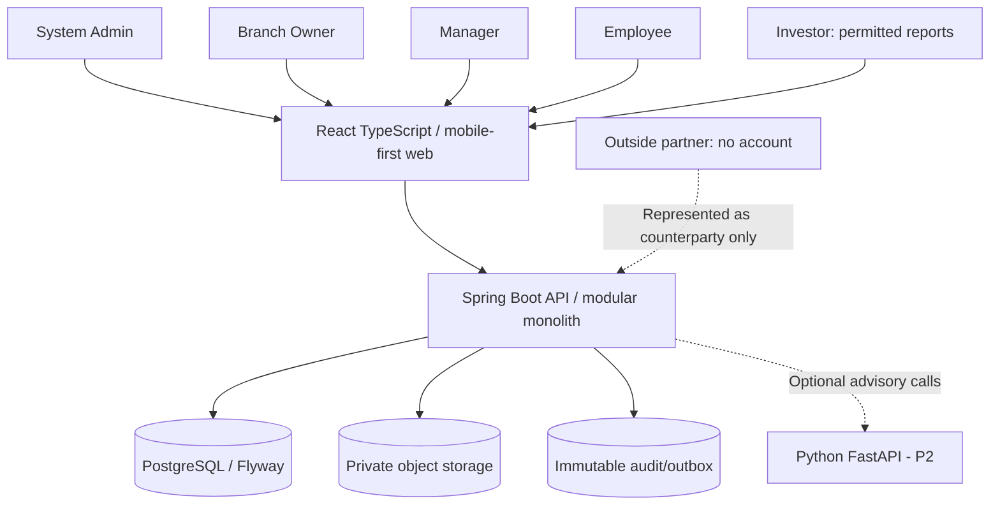
**Security boundary:** The API authenticates every action and verifies both business-entity/branch membership and per-report permissions. React filtering is convenience, not authorization. File download uses per-request server checks and short-lived access tokens; no public evidence buckets.

## 2. Bounded contexts / dependency direction
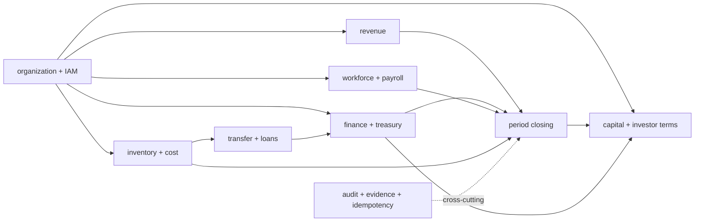
**Implementation rule:** cross-module writes only through published application contracts in one database transaction when possible; no random repository reads into another module’s private tables. Reports read via versioned read models or published projections. `closing` creates snapshots rather than overwriting source financial entries.

## 3. Organization and access ERD
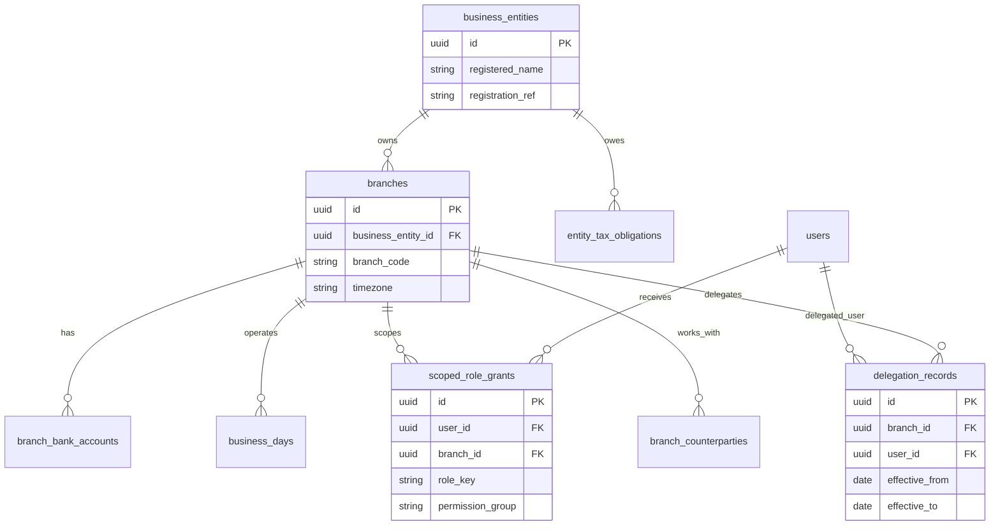
A global Admin grant can have `branch_id=NULL` only for predefined admin scopes. Owner approval is valid only with a delegation effective for the transaction’s approval time; legal authority must be backed by separate agreement and evidence.

## 4. Revenue, cash, debt and closing ERD
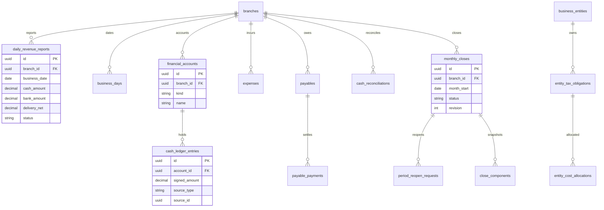
**Revenue semantics:** Confirmed cash/transfer figures can create sourced ledger postings. `delivery_net` counts in approved managerial reporting for sale day but **must not automatically increase bank balance**. A later actual bank deposit must be recorded as an actual settlement/refined financial event with reconciliation, not a second retail sale.

## 5. Workforce and payroll ERD
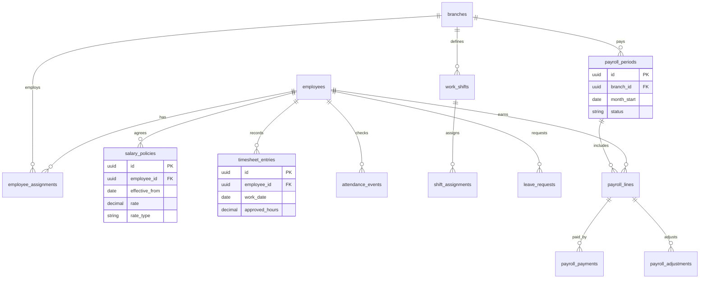
Manager-approved *payable hours* are separate from GPS time. The hourly rate effective on the work date applies. Monthly wage proration uses configured standard/payable days. The full month of a transferred employee belongs to the primary branch effective at **month end**. Overnight shifts are excluded from current operations; the 22:00–22:30 period still needs legally checked night-work treatment.

## 6. Inventory, lots, moving WAC and movements ERD
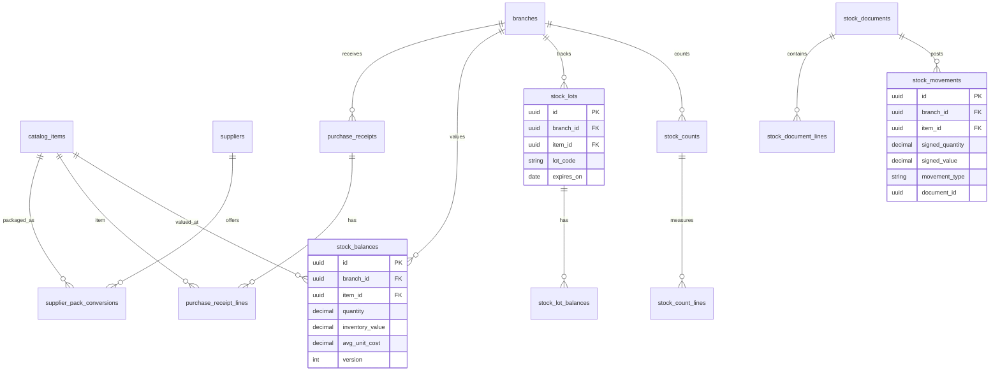
Cost rule: **per-branch moving weighted average**. Use canonical base units, supplier conversion snapshot, decimal arithmetic, row-level balance lock and append-only posting. `stock_lots` govern traceability/expiry; issue valuation remains at branch WAC rather than batch price. Never issue above available or from an expired lot for consumption. Backdated changes require documented correction; do not silently rewrite closed-month WAC.

## 7. Transfers and loans ERD
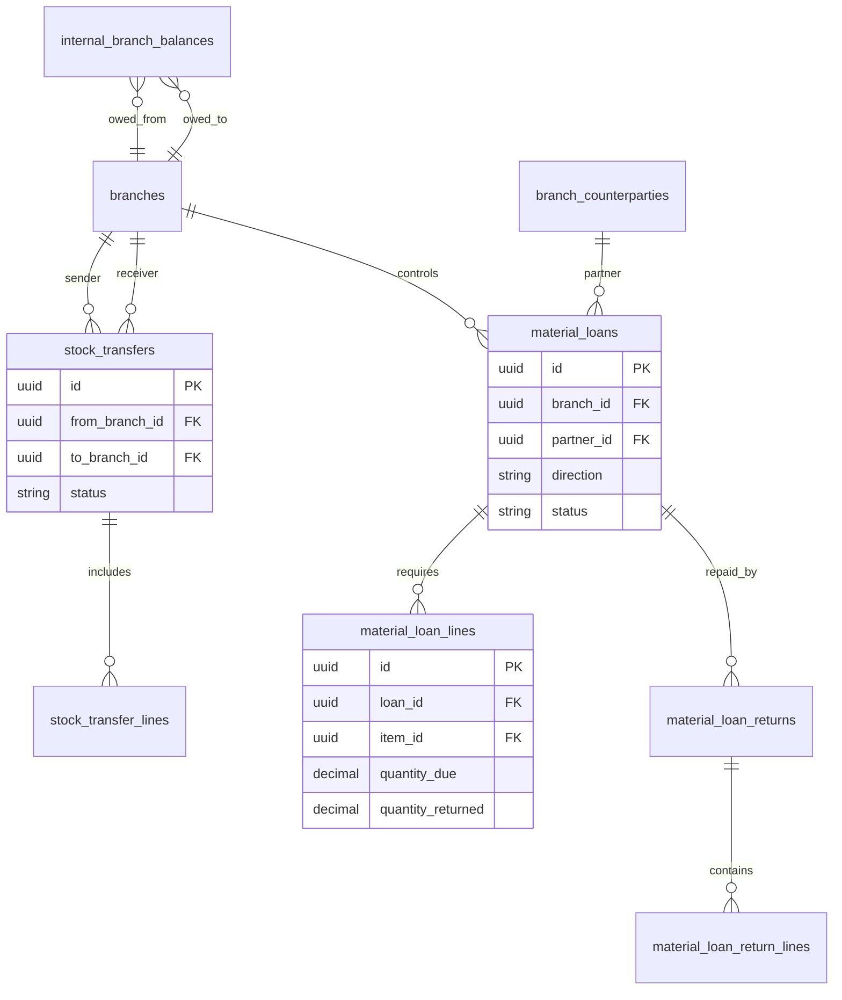
Same entity only: `stock_transfers` with sender WAC, receiver actual quantity, unresolved in-transit balance and mirrored internal due-to/due-from (eliminated at entity consolidation). Different registered entities: use **loan or material sale**, never silent internal transfer. Outside partner has no login. Partial loan return reduces in-kind due only after owner approves receipt; cost variance must remain traceable even if borrowed stock was already consumed.

## 8. Capital and distribution ERD
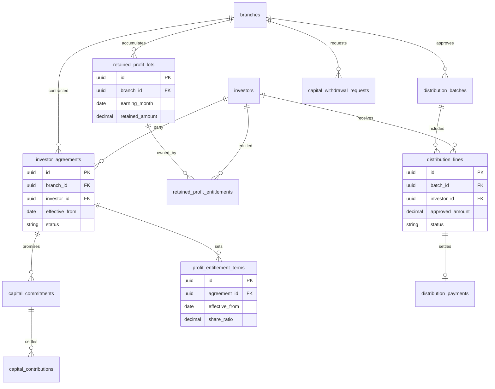
Entitlement ratios are **not** derived automatically from commitments. Snapshot ratios/eligible investor set for the earning month; keep unresolved prior-period entitlements after capital withdrawals. `distribution_payments` max one successful payment per line, full amount only, no partial payout. Approved-but-unpaid line remains `AWAITING_FUNDS` or `APPROVED`. Following period reopen use approved recovery/offset claims, not deletion of historical payments.

## 9. Example sequence: daily business report and bank
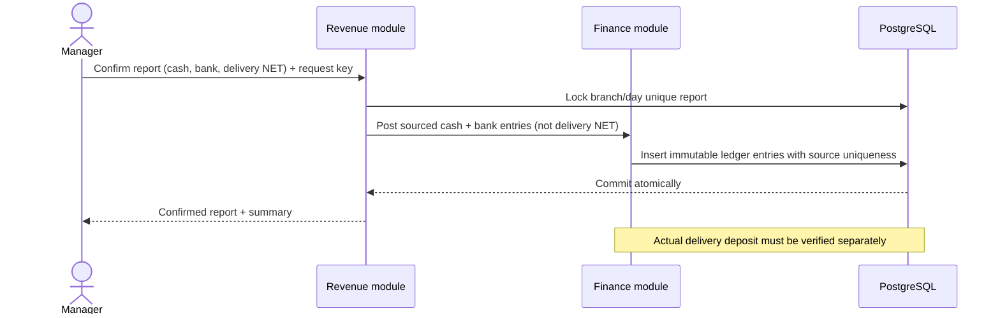

## 10. Example sequence: stock issue at WAC
```mermaid
sequenceDiagram
  actor M as Manager
  participant I as Inventory service
  participant DB as PostgreSQL
  M->>I: Confirm issue(item, qty, lot, requestKey)
  I->>DB: Lock stock_balances(branch,item) FOR UPDATE
  DB-->>I: available qty, avg cost, version
  alt Expired lot or qty insufficient
    I-->>M: Conflict; no postings
  else Valid issue
    I->>DB: Insert movement with WAC snapshot
    I->>DB: Update balances/lot and source ledger once
    DB-->>I: Atomic commit
    I-->>M: Posted document
  end
```

## 11. State machines (proposed)
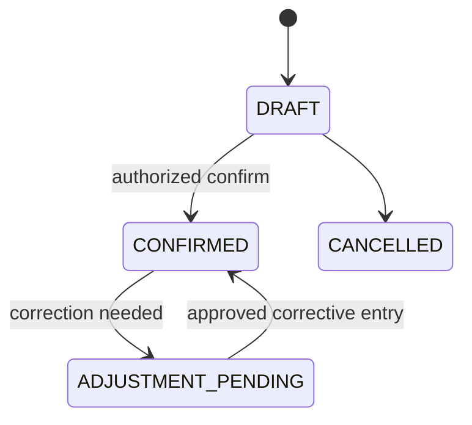
Daily report or stock document statuses must not be confused with monthly period status. Closed financial period requires a different approval state and version:
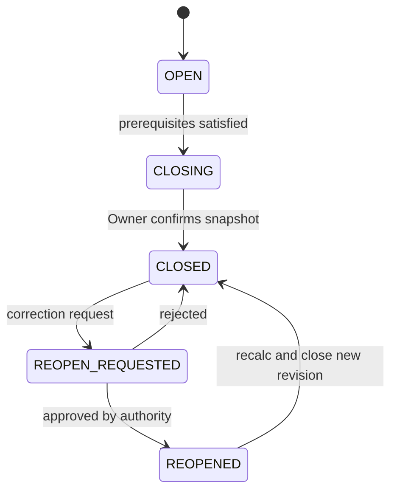
Loan states: `DRAFT -> DISPATCHED/RECEIVED -> PARTIALLY_RETURNED -> SETTLED`; transfer states: `DRAFT -> DISPATCHED -> RECEIPT_PARTIAL/DISPUTED -> COMPLETED`. Approved distributions: `DRAFT -> APPROVED/AWAITING_FUNDS -> PAYMENT_PENDING -> PAID`, with `FAILED` and `CANCELLED` controlled. No money disappears on retries.

## 12. API contract conventions (proposed)
| Area | Example endpoints | Important controls |
|---|---|---|
| `/api/v1/entities /branches` | `GET, POST, PATCH` | Admin + entity/branch scope |
| `/api/v1/branches/{branchId}/business-days` | `GET, PUT` | CLOSED vs OPEN day reason |
| `/api/v1/branches/{branchId}/daily-revenue` | `GET, POST, /{id}/confirm` | One report/day, request key |
| `/api/v1/branches/{branchId}/cash-entries` | `GET, POST, /reconcile` | Actual funds; source unique |
| `/api/v1/branches/{branchId}/expenses` | `GET, POST, /{id}/confirm` | Manager confirms, Owner review |
| `/api/v1/branches/{branchId}/employees` | `GET, POST, PATCH` | Policy effective date |
| `/api/v1/branches/{branchId}/payroll` | `GET, POST, /{id}/approve` | Approved hours and snapshot |
| `/api/v1/branches/{branchId}/stock/receipts` | `GET, POST, /{id}/post` | Base units + WAC |
| `/api/v1/branches/{branchId}/stock/issues` | `GET, POST, /{id}/post` | No negative stock |
| `/api/v1/branches/{branchId}/monthly-close` | `GET, POST, /reopen-request` | Prerequisites, reason, revision |
| `/api/v1/branches/{branchId}/transfers` | `GET, POST, /receive` | Only intra-entity (P1) |
| `/api/v1/branches/{branchId}/material-loans` | `GET, POST, /returns` | Qty due, partial return (P1) |
| `/api/v1/branches/{branchId}/investor-agreements` | `GET, POST, PATCH` | Terms effective-date (P1) |
| `/api/v1/branches/{branchId}/distributions` | `GET, POST, /approve, /pay` | Full-single payout and funds gate (P1) |
Common: `Authorization`, `Idempotency-Key` on unsafe write, `If-Match` or version token for mutable drafts, RFC-7807-like problem response, local business date `YYYY-MM-DD`, timestamp stored in UTC. No API should accept arbitrary `branchId` without cross-checking membership and target ownership. All V1 endpoints are planned, not implemented.

## 13. Traceability and open policies
| Policy | Status | Design consequence |
|---|---|---|
| ADR-025 — Stack and deployment | PROPOSED | Java/Spring Boot modular monolith, PostgreSQL, React TypeScript, Flyway and Docker. |
| ADR-026 — Stock backdating | PROPOSED | Closed period and prior WAC values can be corrected only by controlled re-open or posted current adjustment, never silent edit. |
| ADR-027 — Loans cost variance | POLICY_VERIFY | Borrowed item uses receiving branch reference WAC or approved value; financial difference tracked on in-kind repayment. |
| ADR-028 — Profit distribution compliance | POLICY_VERIFY | Final distribution conditions must be verified against actual household agreement, tax and liabilities. |
| ADR-029 — Labour compliance | POLICY_VERIFY | Night work after 22:00, rest breaks, overtime and payroll deductions need legal-policy validation. |
| ADR-030 — Delivery app cash posting | PROPOSED | App net in daily report must not auto-post as bank funds; when actual funds arrive manually reconcile without duplicate sales. |
| ADR-031 — Monetary rounding | PROPOSED | Use Decimal NUMERIC, record amounts to 2 decimals; payout residual cent assignment deterministic. |

## 14. SQL mapping and split-migration strategy
The companion `MTMS_PostgreSQL_Schema_Starter_v1_0.sql` includes a **proposed conceptual starter** with core P0 and future P1 structures; it is **not** a production migration or evidence of executed schema. Before coding, split by dependency into immutable Flyway `V001__...` and onward, verify constraint names/order, add integration tests, and never modify an applied migration. At minimum, install constraints for one branch/day report, source posting uniqueness, nonnegative balances, one successful full payout per entitlement line, effective-date collision checks and one branch–bank account go-live gate. Cross-module accounting integrity remains transaction/service responsibility; a schema by itself is insufficient.

## 15. Gate alignment
- **G0 (P0)** Requirements signoff: Business owner accepts baseline + legal/tax/labor verify flags and no-POS boundary.
- **G1 (P0)** Foundation ready: Branch-scoped auth, base schema, audit, idempotency and CI verified.
- **G2 (P0)** Revenue/finance pilot: One branch enters 2 weeks daily revenue + expenses and reconciles cash.
- **G3 (P0)** MVP close: One real month closed; revenue dates & payroll complete; P&L flagged provisional; backup restored.
- **G4 (P1)** Stock/HR rollout: GPS policy, transfers/loans, lot controls and accounting approvals signed off.
- **G5 (P1)** Capital payout enablement: Accountant/legal agreement policy verified; approved payout test, no partial transfer, recover/offset tested.
- **G6 (P1)** V1 rollout: Multi-branch test, permissions, finance/cost and regression suite passed.
- **G7 (P2)** Optional AI release: Privacy/evaluation human-review gate and business ROI assessed.
