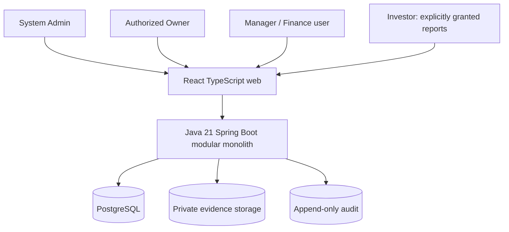
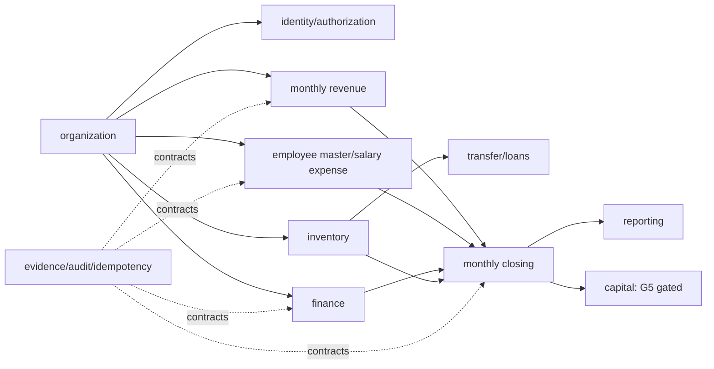
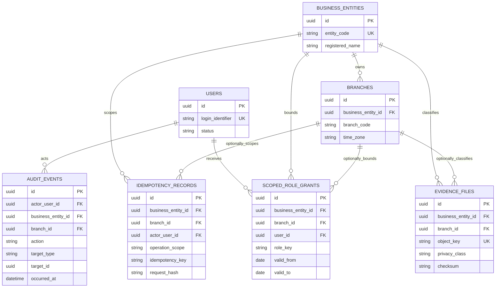
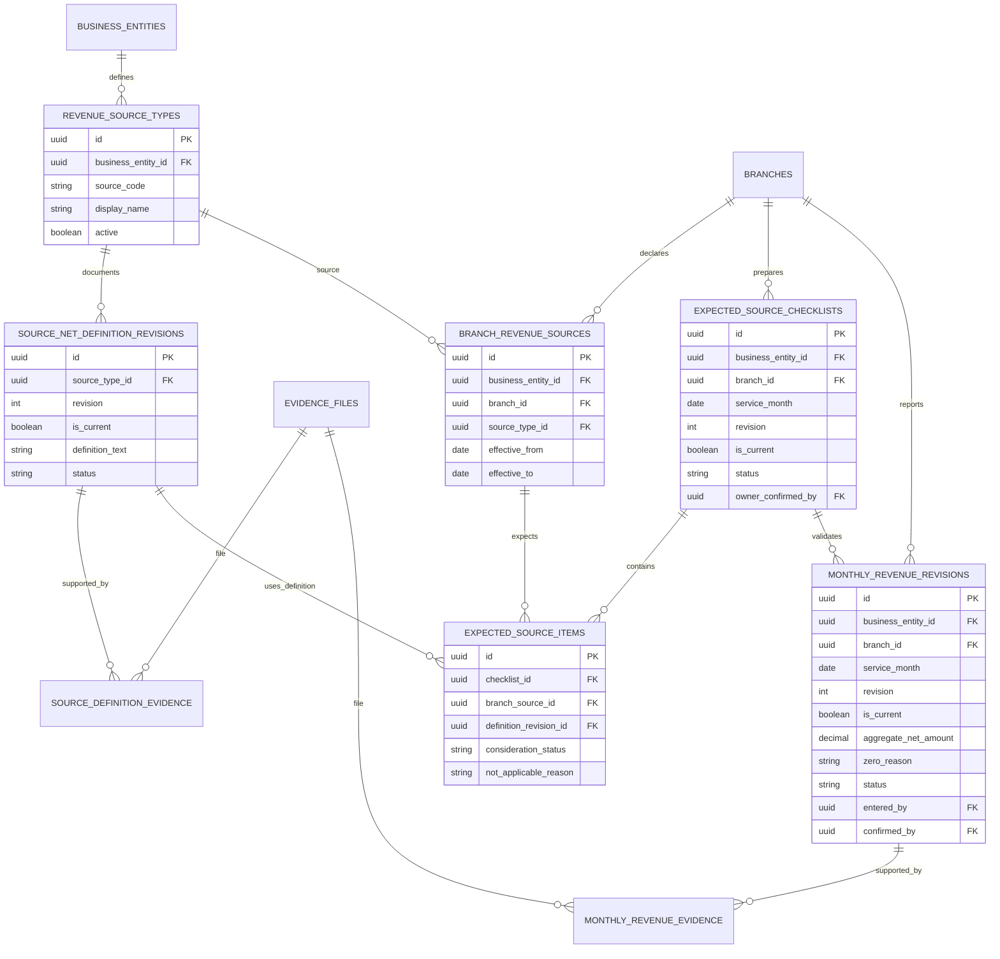
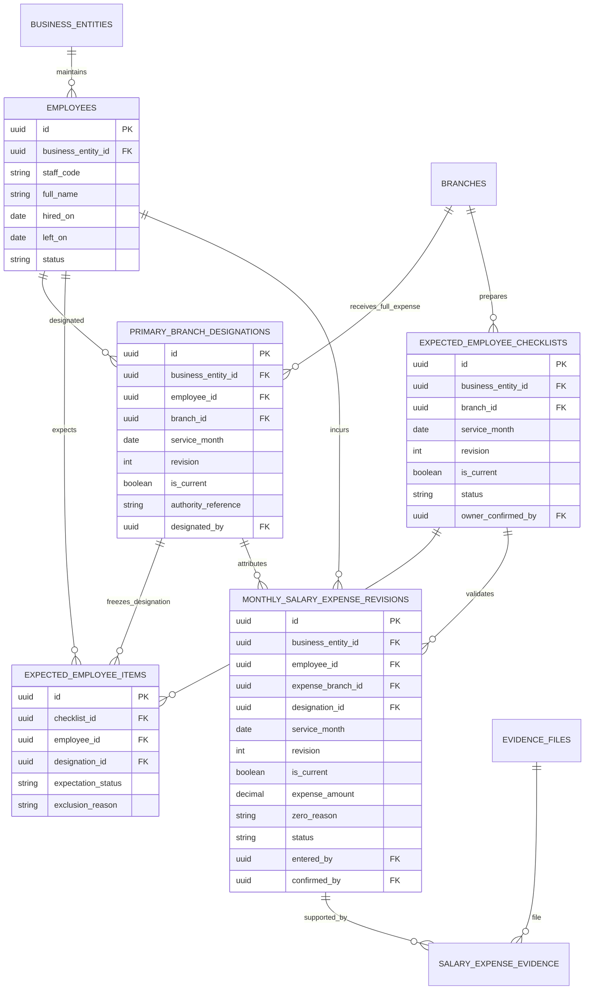
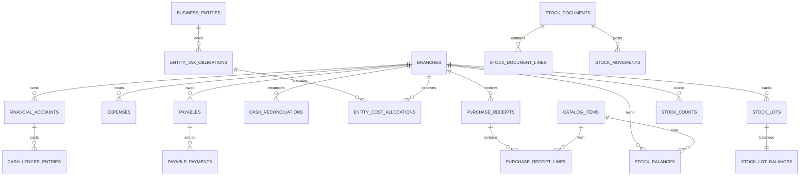
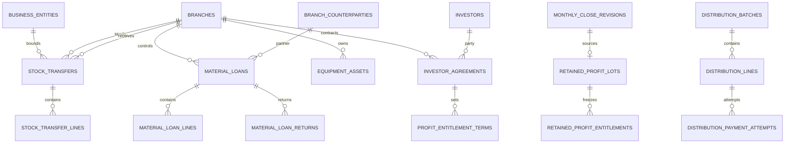
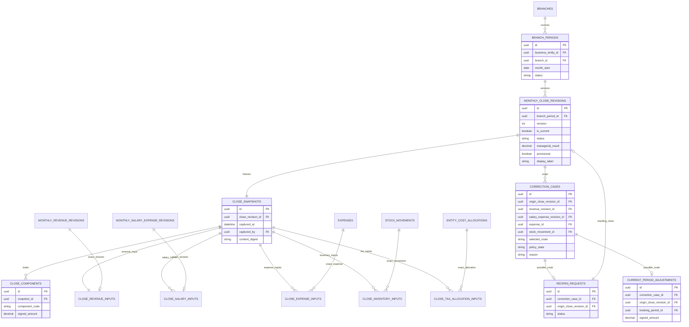
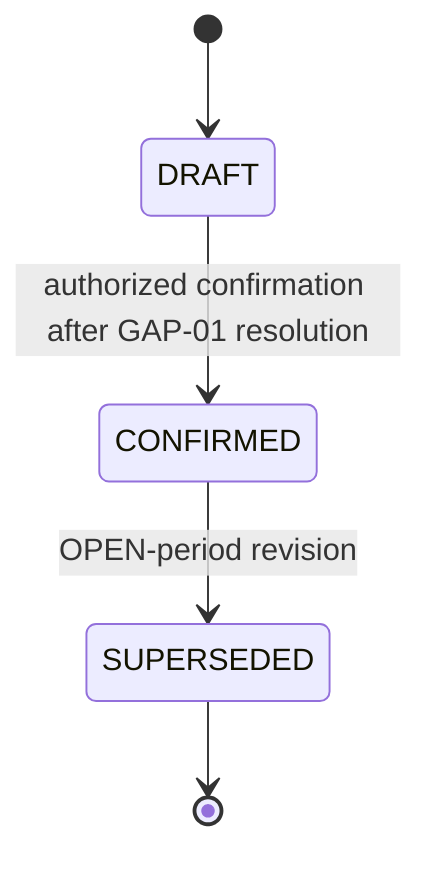
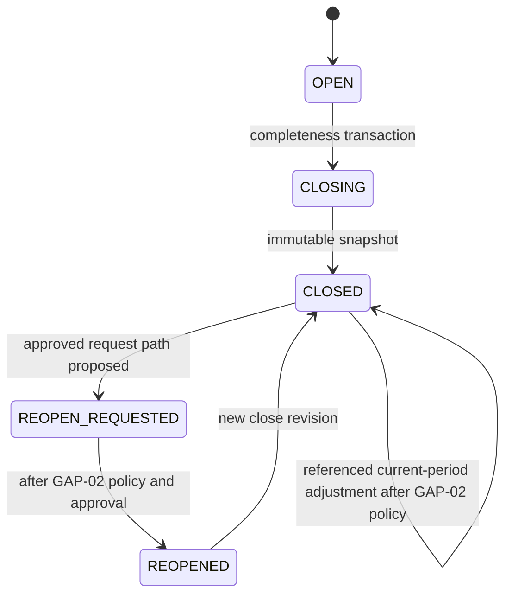

# MTMS ERD & System Architecture v1.1 — PROPOSED

> **PROPOSED / REVIEW_ONLY / NOT AN EXECUTABLE MIGRATION**  
> Date: 2026-11-12 · Parent: `CHANGE-REQUEST-TBD` · Gate: **G0 NOT SIGNED**  
> This document proposes a replacement architecture view for review. It does not modify or supersede the v1.0 baseline without formal change-control.

## 1. Context and trust boundaries

Employees are master-data subjects, not authenticated actors. There is no employee portal. API authorization is entity/branch/action/row scoped; frontend filtering is not a security boundary.

## 2. Bounded contexts

## 3. Organization, identity and security

Composite `(business_entity_id, branch_id)` foreign keys are required wherever both appear. Evidence links are domain-specific so a salary or revenue record cannot reference another branch's evidence.

## 4. Monthly aggregate NET revenue

There is deliberately no amount on source type, source definition, branch source or checklist item. The sole beverage-revenue amount is `MONTHLY_REVENUE_REVISIONS.aggregate_net_amount`. It creates no relation to financial accounts, cash ledger, receivable or settlement.

## 5. Employee master and monthly salary expense

`EMPLOYEES` has no user/login foreign key. The composite designation reference forces employee, service month and expense branch to match. The model contains no attendance, GPS, shift, schedule, leave, payable time, rate, payroll component, payable or payment entity.

## 6. Finance and inventory retained scope

Finance remains actual-money/debt state only. Monthly aggregate revenue and salary expense do not create finance rows. Inventory remains manual per-branch moving WAC with no negative available stock and no expired-lot consumption.

## 7. Transfers, loans, assets and capital retained scope

Transfer branch references share one business entity. Capital and distribution remain separate from software roles. Distribution activation requires G5 verification; a provisional close is not payout authorization.

## 8. Period close, immutable snapshot and correction references

`selected_route` is nullable while `GAP-02` is unresolved. Both reference paths exist, but this ERD assigns no error type to either route. A close snapshot points to exact input revisions, never to a mutable “current” query.

## 9. State models

The transition to `CONFIRMED` is a documented capability, not release enablement. `GAP-01` blocks it until explicit policy change-control.

## 10. Required relational invariants

1. Every branch-scoped child carries a composite FK to `(business_entity_id, branch_id)`.
2. Every service month is the first day of a month.
3. Monetary normal-entry values are exact scale 2 and nonnegative; zero requires a nonblank reason.
4. One current revenue revision per branch/month and one current salary revision per employee/month use partial unique indexes.
5. Expected-source items have no amount column.
6. Salary expense branch equals the exact primary-branch designation revision.
7. Checklist headers/items and aggregate/salary revisions share entity, branch and month through composite FKs.
8. Close inputs reference exact revisions, not current aliases or JSON-only provenance.
9. Immutable CLOSED snapshots require restrictive DB privileges/service guards plus negative tests.
10. Idempotency uniqueness includes entity, actor, operation and key; business uniqueness remains separately enforced.
11. Evidence is private and linked through scope-matching join tables.
12. Capital payout remains disabled until G5; P&L always displays **TẠM TÍNH / PROVISIONAL**.

## 11. Explicitly removed entities

The v1.1 proposal contains none of the following: `salary_policies`, `work_shifts`, `shift_assignments`, `attendance_events`, `leave_requests`, `timesheet_entries`, `payroll_periods`, `payroll_lines`, `payroll_adjustments`, `payroll_payments`, daily revenue reports, app settlement, salary payable/payment or employee login link.

## 12. Review status

- Architecture: **PROPOSED**.
- Schema readiness: **NO / BLOCKED**.
- G0: **NOT SIGNED**.
- Open: `GAP-01…09`, `BR-FIN-08`, `BR-CAP-10`/G5.
- Application code, migration and database execution: **NOT AUTHORIZED / NOT RUN**.

