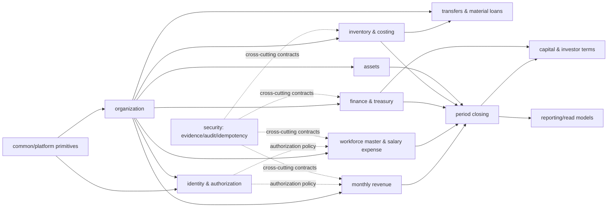
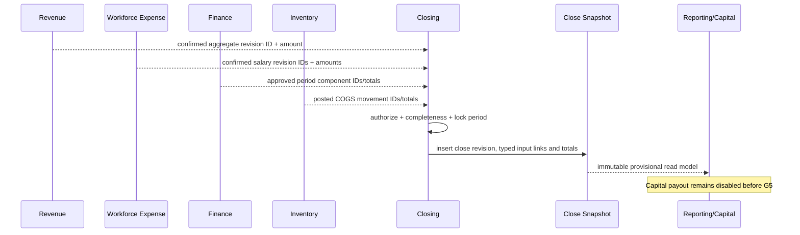

# MTMS Project Architecture v1.1 — PROPOSED

> **PROPOSED / REVIEW_ONLY / NOT IMPLEMENTATION APPROVAL**  
> Date: 2026-11-12 · Parent: `CHANGE-REQUEST-TBD` · Gate: **G0 NOT SIGNED**  
> This is architecture documentation only. It is not a G0 signoff, task approval, executable migration, deployment plan, or permission to change the Tracker.

## 1. Decision basis and precedence

This proposal is derived from, in precedence order:

1. `MTMS_Business_Spec_Roadmap_v1_0.docx`, except scope explicitly proposed for replacement by the v1.1 change plan.
2. `MTMS_HR_SCOPE_CHANGE_PROPOSAL_v1_1.md`, including Owner decisions `DEC-01…14` and unresolved `GAP-01…09`.
3. `MTMS_Implementation_Handbook_v1_0.md` for retained module, security, transaction, audit, inventory, capital and gate invariants.
4. ERD and SQL Starter v1.0 as proposed technical inputs, not executable baselines.

When the sources conflict, this document records the conflict and does not silently resolve it. In particular:

- `GAP-01` remains `BLOCKED_POLICY_CONFLICT`: same-actor entry/confirmation conflicts with the baseline no-self-approval control. The data model records both actors neutrally; release must remain disabled until explicit change-control resolves the conflict.
- `GAP-02` remains `POLICY_VERIFY`: both reopen and current-period adjustment can be represented and traced, but this design does not classify errors or choose a route.
- Source definitions (`GAP-03`), acceptance of lost source reconciliation (`GAP-04`), primary-branch designation authority (`GAP-05`) and checklist preparation/freeze ownership (`GAP-06`) remain open.

## 2. Mandatory product boundaries

- One aggregate NET beverage-revenue amount per branch and sale/service month.
- Multiple declared sources, but source definitions, checklist items and evidence are metadata only; no source-level amount exists.
- Aggregate revenue creates no cash, bank, receivable or settlement state.
- NO POS: no order, cup, cart, checkout, customer payment or automatic recipe consumption.
- Employee is master data only and has no MTMS login or self-service.
- One exact-decimal salary-expense amount per employee/service month, entirely attributed to the Owner-designated primary branch.
- No GPS, attendance, shifts, schedules, leave, payable time, rates, payroll calculation, payroll liability, salary payment or payslip.
- OPEN changes create revisions and preserve history. CLOSED data changes only through controlled reopen or referenced current-period adjustment after `GAP-02` is resolved.
- P&L always displays **TẠM TÍNH / PROVISIONAL**. Real payout remains disabled before G5 and `BR-CAP-10` verification.

## 3. Architectural style

The proposed runtime remains a Java 21 Spring Boot modular monolith, React TypeScript/Vite web client and PostgreSQL database. ADR-025 remains **PROPOSED** until G0 review.

Rules:

- Each business module owns its application services and persistence tables.
- Modules call published application contracts, not another module's repositories or internal persistence entities.
- Same-request financial or stock effects use synchronous application contracts inside one explicit database transaction.
- Read-heavy reports use published projections/read models. Closing snapshots exact source revisions rather than recomputing mutable source data.
- Async outbox is reserved for a demonstrated external integration/notification need; it is not required to make internal financial writes eventually consistent.
- `common` contains technical primitives only. It must not become a shared business-model dumping ground.

## 4. Bounded contexts and dependency direction



Allowed direction is downstream only. `closing` consumes immutable identifiers and projections published by revenue, workforce-expense, finance, inventory and assets. Those source modules never depend on closing. `capital` may consume a G5-eligible close snapshot but must not mutate a close.

## 5. Proposed repository and package tree

This is a placement proposal only. No directories or source code are created by this review.

```text
mtms/
├── backend/
│   ├── pom.xml
│   └── src/
│       ├── main/java/com/mtms/
│       │   ├── common/                 # UUID/time/decimal/error primitives only
│       │   ├── organization/           # entity, branch, branch master
│       │   ├── identity/               # users, grants, scoped authorization
│       │   ├── security/               # evidence, audit, idempotency
│       │   ├── revenue/                # source metadata/checklist/monthly aggregate
│       │   ├── workforce/              # employee master/designation/salary expense
│       │   ├── finance/                # cash/bank/expense/debt/tax; no revenue settlement
│       │   ├── inventory/              # receipts, manual issues, lots, WAC
│       │   ├── movement/               # transfers and in-kind material loans
│       │   ├── assets/                 # equipment and theoretical recipes
│       │   ├── closing/                # period state, snapshots, corrections
│       │   ├── capital/                # investor agreements; payouts G5-gated
│       │   └── reporting/              # branch-scoped read models
│       ├── main/resources/
│       └── test/java/com/mtms/          # mirrors module ownership
├── frontend/
│   └── src/
│       ├── app/                         # shell, routing, session
│       ├── shared/                      # technical UI primitives
│       ├── features/organization/
│       ├── features/revenue-monthly/
│       ├── features/workforce-expense/
│       ├── features/finance/
│       ├── features/inventory/
│       ├── features/closing/
│       ├── features/capital/
│       └── features/reporting/
├── database/migrations/                 # remains empty until G0/task approval
├── docs/api/                             # future reviewed contracts
├── docs/decisions/                       # future approved/proposed ADRs
├── tests/                                # future contract/E2E tests
└── infra/                                # future task-authorized runtime material
```

There is no employee-facing frontend feature because employees do not log in. There are no attendance, schedule, leave, payroll, settlement or POS packages.

## 6. Module ownership

| Module | Owns | Must not own |
|---|---|---|
| organization | business entities, branches, branch settings | authentication grants, financial balances |
| identity | users, scoped grants, authorization decisions | employee master identity, investor entitlement |
| security | evidence metadata/access, audit events, idempotency records | domain state transitions |
| revenue | source catalog/NET-definition metadata, expected-source checklist, monthly aggregate revisions | cash/bank/receivable/settlement or source amounts |
| workforce | employee master, monthly primary-branch designation, expected-employee checklist, salary-expense revisions | login, attendance, time, rate, payroll or payment |
| finance | actual cash/bank ledger, expenses, payables/receivables, tax obligations | monthly revenue settlement assumptions, salary payment |
| inventory | catalog, receipts, balances, lots, manual documents, WAC movements | POS-driven consumption |
| movement | same-entity transfers, external in-kind loans | silent inter-entity internal transfer |
| closing | period status, readiness evaluation, immutable close revisions/snapshots, correction references | rewriting source module records |
| capital | agreements, commitments, entitlement snapshots, G5-gated distributions | treating provisional P&L as payout authority |
| reporting | branch/entity-scoped projections and exports | authoritative postings |

## 7. Transaction boundaries

### 7.1 Monthly revenue revision

One transaction must:

1. authorize entity, branch, action and target row;
2. lock/current-check the branch/service-month aggregate and checklist revision;
3. validate month-start, scale 2, nonnegative amount and zero reason;
4. validate the Owner-confirmed source checklist without reading any source amount;
5. supersede the prior current row and insert the new current revision;
6. attach evidence metadata links, audit and idempotency result;
7. create no finance/cash/receivable/settlement entry.

### 7.2 Monthly primary-branch designation and salary expense

One designation transaction records employee, service month, branch, actor, authority reference and revision. Because `GAP-05` is open, the application cannot infer the branch from operational movement.

One salary-expense transaction locks/current-checks the employee/service month, resolves the exact designation revision, validates scale 2/nonnegative/zero reason, and inserts a revision. The composite foreign key ensures the expense branch equals the designated branch. No payroll liability or payment posting is emitted.

### 7.3 Close

One close transaction must:

1. lock the branch period;
2. verify the Owner-confirmed expected-source and expected-employee checklist revisions;
3. verify exactly one confirmed current revenue revision and every expected employee's confirmed salary revision/designation;
4. reject missing, negative, zero-without-reason or unresolved correction records;
5. capture exact source revision IDs and component totals into immutable snapshot tables;
6. insert the new close revision and mark the prior close revision non-current;
7. write audit/idempotency records;
8. label the result **TẠM TÍNH / PROVISIONAL**.

Completeness across a variable checklist and immutable-after-close behavior require a service transaction plus database constraints/privilege controls; a simple row `CHECK` cannot prove them.

### 7.4 CLOSED correction

A correction case always references the original close and affected source revision. Its route is initially unset and policy state remains `POLICY_VERIFY`. The schema can later reference either an approved reopen/reclose revision or a current-period adjustment, but service release must reject route selection until `GAP-02` is resolved. No error classification is inferred in this proposal.

### 7.5 Retained transactions

- Inventory receipt/issue: lock branch/item balance, validate lot/expiry, insert movement and update WAC atomically.
- Cash/debt: append sourced ledger and debt effect atomically with composite branch references and source uniqueness.
- Transfers: same `business_entity_id` is present in both branch foreign keys; external moves use material loan/sale contracts.
- Capital payout: remains unavailable before G5; retries and successful full-payment uniqueness require a separately approved contract.

## 8. Read-model and snapshot flow



Snapshot provenance is normalized into typed link tables for revenue, salary and retained finance/inventory sources. JSON may be used only for non-authoritative display metadata; it must not replace important foreign keys or amounts.

## 9. Security, privacy, evidence, audit and idempotency

- Every command and query resolves principal → entity scope → branch scope → action → row ownership on the server.
- Branch IDs in URLs or payloads are never trusted without composite ownership checks.
- Salary details, employee identity and related evidence are private by default. Investors receive no access unless a separately reviewed permission explicitly grants an aggregated report.
- Evidence objects live in private storage. Metadata carries entity/branch classification; domain-specific link tables bind evidence to the correct row. Downloads require a fresh authorization decision and short-lived token.
- Audit is append-only and records actor, effective scope, action, target, business month, reason, correlation/idempotency reference and safe digests. It must not copy private salary values into general logs.
- Idempotency scope includes entity, optional branch, actor, operation and key. Payload-hash reuse conflicts; business uniqueness and source-link constraints remain required because a different actor can retry the same business effect.
- Authorization and immutable-close negative tests remain mandatory even if PostgreSQL RLS is later adopted. RLS would be defense in depth, not the only control.

## 10. Database versus service enforcement

| Enforced in PostgreSQL | Requires transaction/service enforcement |
|---|---|
| exact numeric scale/type; nonnegative normal values; zero reason; month-start; revision positive | source definition content and checklist preparation authority |
| composite entity/branch foreign keys | entity/branch/action/row authorization decision |
| one current revision by partial unique index | atomic current-row supersession under concurrency |
| employee/month designation matches salary branch | who may designate/change a primary branch (`GAP-05`) |
| typed snapshot input references | checklist completeness and frozen-at-close semantics (`GAP-06`) |
| source/checklist metadata has no amount column | assertion that external aggregate truly covers all sources |
| closed snapshot rows have restrictive references | prevention of UPDATE/DELETE via service/DB privileges and tests |
| idempotency-scope uniqueness and request hash | response replay, conflict semantics and business-effect deduplication |
| correction origin/target references | route selection (`GAP-02`) and accounting treatment |
| provisional label and G5 fields | external legal/accounting verification (`BR-CAP-10`) |

## 11. Traceability and supersession proposal

| Baseline | v1.1 impact | Proposed tests/decision |
|---|---|---|
| `BR-REV-01…04`, `ADR-005/006/030` | replace daily/channel/cash-linked capture with monthly aggregate and no-money boundary | `TC-057…059`, proposed `ADR-032/034` |
| `BR-HR-01…10`, `ADR-014…016/029` | remove time/rate/payroll/payment; retain employee master and manual salary expense | `TC-060…065`, proposed `ADR-033/035` |
| `BR-FIN-01/03`, `ADR-007` | P&L consumes service-month values; cash remains separate | `TC-059/060/066`; retain `ADR-007` |
| `BR-CLS-01…04`, `ADR-017/026` | monthly checklist completeness, immutable snapshots, neutral correction references | `TC-064/066/067`, proposed `ADR-036` |
| `BR-SEC-01/03` | retain private evidence, scoped auth, audit and idempotency | `TC-063/065` |
| `ADR-001` | retain NO POS without expansion | `TC-057` |
| `BR-CAP-10`, `ADR-028` | unchanged POLICY_VERIFY/G5 payout block | existing G5 tests |

Task and TC identifiers proposed in the scope-change plan remain placeholders until authorized baseline/Tracker change-control. This document changes no task status.

## 12. Readiness and blockers

- Architecture status: **PROPOSED**.
- Task readiness: **BLOCKED / DOCUMENTATION_ONLY**.
- Schema readiness: **NO / BLOCKED** while policy GAPs and static defects remain.
- Implementation authorization: **NONE**.
- Migration/DB execution: **NOT RUN / FORBIDDEN**.
- Unresolved: `GAP-01…09`, G0, `BR-FIN-08`, `BR-CAP-10`/G5.

