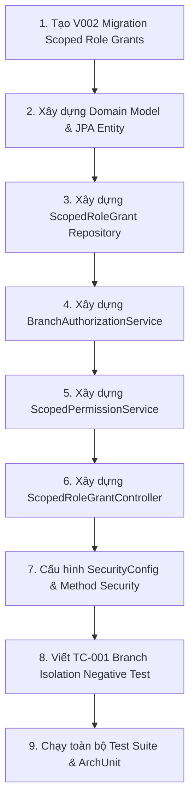

# Task brief — P0-ORG-05 Scoped permissions (PLANNING)

- **Prepared:** 2026-11-14
- **Gate status:** `G0 SIGNED` on 2026-11-13; `P0-ORG-01`, `P0-ORG-02`, `P0-ORG-03`, `P0-ORG-04`, và `P0-SEC-06` đã hoàn thành và nghiệm thu.
- **Parent Task:** `P0-ORG-05` — Scoped permissions.
- **BR IDs:** `BR-ORG-04` (`BASELINED`), `SEC-INV-01`, `ORG-INV-01`, rule `03-branch-authorization.md`.
- **TC IDs:** `TC-001` (Security isolation: User từ Chi nhánh A cố tình truy cập tài nguyên của Chi nhánh B -> Bị từ chối 403 Forbidden không lộ dữ liệu).
- **Dependency IDs + status:** `P0-ORG-04` (Authentication và JWT Session) đã hoàn tất và vượt qua 47 automated tests.
- **Owner / reviewers:** Business Owner (phê duyệt & nghiệm thu), Tech Lead (điều phối & giám sát ranh giới), Architect (kiến trúc phân quyền & schema), Backend Engineer (thực thi mã nguồn), QA Reviewer (kiểm thử độc lập).

---

## 1. Mục tiêu nghiệp vụ (Business Intent) & Định nghĩa Hoàn thành (DoD)

### 1.1 Business Intent
- Xây dựng cơ chế phân quyền theo phạm vi chi nhánh (Branch-Scoped Role Grants) và pháp nhân (Business Entity Scope) chặt chẽ trên máy chủ (Server-side Authorization).
- Đảm bảo tính cô lập tuyệt đối dữ liệu đa chi nhánh: Mỗi chi nhánh hoạt động độc lập, nhân sự của chi nhánh A tuyệt đối không được xem hay thao tác trên dữ liệu (doanh thu, chi phí, kho, nhân sự) của chi nhánh B.
- Kiểm soát các vai trò cốt lõi trong chuỗi:
  - `SYSTEM_ADMIN`: Toàn quyền hệ thống, không gán theo chi nhánh đơn lẻ (`branch_id IS NULL`).
  - `BRANCH_OWNER`: Chủ cơ sở / Chủ sở hữu chi nhánh, được quản lý các chi nhánh trực thuộc pháp nhân của mình.
  - `MANAGER`: Quản lý quán theo chi nhánh cụ thể (`branch_id NOT NULL`), có quyền nhập báo cáo ca, kiểm kho, duyệt giờ công nhân viên trong quán (cấm tự duyệt giờ công của mình).
  - `FINANCE`: Nhân viên kế toán/thủ quỹ phụ trách chi nhánh hoặc toàn chuỗi.
  - `EMPLOYEE`: Nhân viên phục vụ/pha chế (không có quyền quản trị chi nhánh, chỉ xem lương cá nhân).
  - `INVESTOR`: Nhà đầu tư (chỉ có quyền xem các báo cáo tổng hợp được chỉ định; mặc định từ chối xem chi tiết lương và GPS).
- Ràng buộc hiệu lực theo thời gian: Quyền chỉ có giá trị khi `valid_from <= today <= valid_to`. Quyền hết hạn tự động bị vô hiệu hóa.

### 1.2 Definition of Done (DoD)
1. **Migration V002:** Tạo bảng `mtms.scoped_role_grants` với đầy đủ khóa ngoại, composite foreign key `(business_entity_id, branch_id)`, check constraints và index tra cứu quyền nhanh `(user_id, branch_id, role_key, valid_from, valid_to)`.
2. **Domain & Persistence:** Entity `ScopedRoleGrant`, enum `RoleKey`, repository tra cứu quyền active của user theo thời gian thực.
3. **Authorization Engine:** `BranchAuthorizationService` kiểm tra quyền theo thời gian thực (Server-side enforcement), tích hợp vào Spring Security Context.
4. **TC-001 Boundary Test:** Kiểm thử tự động chứng minh: User thuộc Chi nhánh A khi gửi request đến endpoint của Chi nhánh B bắt buộc nhận mã HTTP **403 Forbidden** với RFC 7807 Problem Detail `urn:mtms:error:forbidden`, tuyệt đối không rò rỉ dữ liệu của Chi nhánh B.
5. **Cấp & Thu hồi quyền:** API quản trị cho phép System Admin / Owner cấp quyền (`POST /api/v1/auth/grants`), xem danh sách quyền (`GET /api/v1/auth/users/{userId}/grants`) và thu hồi quyền (`DELETE /api/v1/auth/grants/{grantId}`).
6. **Kiểm soát ranh giới kiến trúc:** `ModuleBoundaryTest` (ArchUnit) đạt 100% PASS; toàn bộ test suite chạy thành công không có lỗi.

---

## 2. Phạm vi thực thi (Scope)

### 2.1 Trong phạm vi (In Scope)
1. **Database Migration:**
   - Tạo file `database/migrations/V002__create_scoped_role_grants.sql` theo chuẩn Flyway.
2. **Domain Layer (`com.mtms.identity.domain`):**
   - `RoleKey`: Enum đại diện cho các vai trò (`SYSTEM_ADMIN`, `BRANCH_OWNER`, `MANAGER`, `FINANCE`, `EMPLOYEE`, `INVESTOR`).
   - `ScopedRoleGrant`: Domain model đại diện cho một bản ghi phân quyền theo chi nhánh và thời gian hiệu lực.
3. **Persistence Layer (`com.mtms.identity.infrastructure.persistence`):**
   - `ScopedRoleGrantJpaEntity`: Ánh xạ bảng `mtms.scoped_role_grants`.
   - `ScopedRoleGrantJpaRepository`: Phương thức truy vấn tìm các quyền đang có hiệu lực (`findActiveGrantsByUser`, `existsActiveGrant`).
4. **Security & Authorization Infrastructure (`com.mtms.identity.infrastructure.security`):**
   - `BranchAuthorizationService`: Dịch vụ kiểm tra thẩm quyền chi nhánh:
     - `boolean hasBranchAccess(UUID userId, UUID branchId, String action)`
     - `void checkBranchAccess(UUID branchId, String action)` -> Ném `AccessForbiddenException` nếu không có quyền.
     - `boolean isSystemAdmin(UUID userId)`
   - Cập nhật `UserPrincipal`: Nạp danh sách quyền chi nhánh vào Spring Security `GrantedAuthority` (ví dụ: `ROLE_SYSTEM_ADMIN`, `SCOPE_BRANCH_<id>_<role>`).
   - Cập nhật `SecurityConfig`: Bật `@EnableMethodSecurity(prePostEnabled = true)`, thêm `AccessDeniedHandler` trả về RFC 7807 Problem Detail (HTTP 403 Forbidden).
5. **Application Layer (`com.mtms.identity.application`):**
   - `ScopedPermissionService`:
     - `ScopedRoleGrantDto grantRole(GrantRoleCommand cmd, UUID actorId)`
     - `void revokeGrant(UUID grantId, UUID actorId)`
     - `List<ScopedRoleGrantDto> getUserGrants(UUID targetUserId)`
   - DTOs: `GrantRoleCommand`, `ScopedRoleGrantDto`.
6. **Web Layer (`com.mtms.identity.web`):**
   - `ScopedRoleGrantController`:
     - `POST /api/v1/auth/grants`
     - `GET /api/v1/auth/users/{userId}/grants`
     - `DELETE /api/v1/auth/grants/{grantId}`
   - Endpoint kiểm thử chi nhánh: Endpoint kiểm tra bảo vệ tài nguyên chi nhánh phục vụ `TC-001` (ví dụ: `GET /api/v1/organizations/branches/{branchId}/protected-summary`).
7. **Testing:**
   - `ScopedRoleGrantServiceTest`: Kiểm tra logic cấp quyền, kiểm tra khoảng ngày `valid_to >= valid_from`, từ chối quyền hết hạn.
   - `BranchAuthorizationSecurityTest` (`TC-001`): Chạy các kịch bản MockMvc kiểm thử cách ly chi nhánh (Cross-branch denial, System Admin override, Expired grant rejection).

### 2.2 Ngoài phạm vi (Explicit Non-Goals)
- Không làm giao diện quản trị phân quyền Frontend (`FE-P0-03` / `P0-ORG-06`).
- Không tạo tài khoản ngân hàng chi nhánh (`P0-ORG-07`).
- Không làm POS, bán hàng, kiểm kho hay giao dịch tài chính.
- Nhân viên floor staff (`Employee`) vẫn là master data ở module `workforce`, không được cấp tài khoản login tùy tiện.

---

## 3. Danh sách tệp được phép tác động (Target Files)

### ADD (Tạo mới)
1. `database/migrations/V002__create_scoped_role_grants.sql`
2. `backend/src/main/java/com/mtms/identity/domain/RoleKey.java`
3. `backend/src/main/java/com/mtms/identity/domain/ScopedRoleGrant.java`
4. `backend/src/main/java/com/mtms/identity/infrastructure/persistence/ScopedRoleGrantJpaEntity.java`
5. `backend/src/main/java/com/mtms/identity/infrastructure/persistence/ScopedRoleGrantJpaRepository.java`
6. `backend/src/main/java/com/mtms/identity/infrastructure/security/BranchAuthorizationService.java`
7. `backend/src/main/java/com/mtms/identity/application/ScopedPermissionService.java`
8. `backend/src/main/java/com/mtms/identity/application/dto/GrantRoleCommand.java`
9. `backend/src/main/java/com/mtms/identity/application/dto/ScopedRoleGrantDto.java`
10. `backend/src/main/java/com/mtms/identity/web/ScopedRoleGrantController.java`
11. `backend/src/test/java/com/mtms/identity/ScopedPermissionServiceTest.java`
12. `backend/src/test/java/com/mtms/identity/BranchAuthorizationSecurityTest.java`

### MODIFY (Chỉnh sửa có kiểm soát)
1. `backend/src/main/java/com/mtms/identity/infrastructure/security/UserPrincipal.java` (Nạp quyền scoped role grants)
2. `backend/src/main/java/com/mtms/identity/infrastructure/security/SecurityConfig.java` (Thêm `@EnableMethodSecurity` và `AccessDeniedHandler`)
3. `backend/src/main/java/com/mtms/identity/application/AuthenticationService.java` (Nạp các grants hợp lệ vào UserDto khi đăng nhập)
4. `backend/src/main/java/com/mtms/identity/application/dto/UserDto.java` (Thêm danh sách role grants tóm tắt)
5. `backend/src/main/java/com/mtms/organization/web/OrganizationController.java` (Áp dụng `@PreAuthorize` hoặc branch scope check cho endpoint chi nhánh)
6. `backend/src/test/java/com/mtms/database/FlywayBaselineMigrationTest.java` (Cập nhật số migration mong đợi từ 1 thành 2)

---

## 4. Kế hoạch triển khai & Kiểm thử chi tiết

### Kịch bản kiểm thử cốt lõi (TC-001):
1. **Scenario 1 (Cùng chi nhánh - Hợp lệ):** User Manager của Chi nhánh Q12 gửi request truy cập dữ liệu Chi nhánh Q12 -> **200 OK**.
2. **Scenario 2 (Khác chi nhánh - Bị từ chối):** User Manager của Chi nhánh Q12 gửi request truy cập tài nguyên Chi nhánh Bình Thạnh -> **403 Forbidden** kèm RFC 7807 problem detail `urn:mtms:error:forbidden`, không tiết lộ nội dung hay sự tồn tại nhạy cảm.
3. **Scenario 3 (Hết hạn quyền):** User có grant nhưng `valid_to < today` -> **403 Forbidden**.
4. **Scenario 4 (System Admin):** User có `SYSTEM_ADMIN` (`branch_id IS NULL`) truy cập bất kỳ chi nhánh nào -> **200 OK**.
5. **Scenario 5 (Chưa đăng nhập):** Request không token -> **401 Unauthorized**.

---

## 5. Rủi ro & Biện pháp phòng ngừa (Risk Mitigation)
- **Rủi ro rò rỉ dữ liệu qua Exception:** Không trả về chi tiết entity nội bộ trong message lỗi 403; luôn chuẩn hóa qua `ProblemDetail` với thông điệp: *"Access to the requested branch resource is forbidden"*.
- **Rủi ro hiệu năng khi kiểm tra quyền:** Đánh index phức hợp `(user_id, branch_id, role_key, valid_from, valid_to)` trên bảng `scoped_role_grants` để thời gian truy vấn quyền dưới 2ms.
- **Tuân thủ ArchUnit:** Không để `domain` phụ thuộc vào `web` hay `infrastructure`. Mọi service interface đều độc lập.
