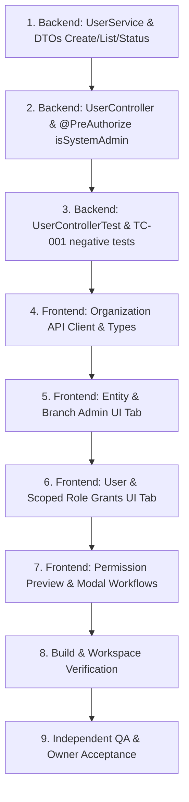

# Task brief — P0-ORG-06 Org and users admin UI (IMPLEMENTED / VERIFIED)

- **Prepared:** 2026-11-14
- **Gate status:** `G0 SIGNED` on 2026-11-13; `P0-ORG-01` through `P0-ORG-05` and `P0-SEC-06` completed, verified, and accepted.
- **Parent Task:** `P0-ORG-06` — Org and users admin UI.
- **Frontend Child:** `FE-P0-04` — Entity, branch and account management screens.
- **BR IDs:** `BR-ORG-01` (`BASELINED` — multi-entity & branch topology), `BR-ORG-04` (`BASELINED` — branch-scoped permissions & roles), `ADR-002` (household-business separation), rule `03-branch-authorization.md`, `FRONTEND_DESIGN_SYSTEM.md`.
- **TC IDs:** `TC-001` (Security isolation: unauthorized non-admin rejected with 403 Forbidden), `TC-003` (Branch onboarding without leaked data).
- **Dependency IDs + verified status:**
  - `P0-ORG-03` (Entity & Branch domain APIs) — `ACCEPTED / VERIFIED`
  - `P0-ORG-04` (Authentication & Security Session) — `ACCEPTED / VERIFIED`
  - `P0-ORG-05` (Scoped Role Grants backend engine) — `ACCEPTED / VERIFIED`
  - `P0-SEC-06` (Responsive Shell UI & Layout) — `ACCEPTED / VERIFIED`
- **Owner / reviewers:** Business Owner (phê duyệt kế hoạch & nghiệm thu), Tech Lead (điều phối kiến trúc), Backend Engineer (API User Admin), Frontend Engineer (UI/UX màn hình Admin), QA Reviewer (kiểm thử độc lập).

---

## 1. Mục tiêu nghiệp vụ (Business Intent) & Định nghĩa Hoàn thành (DoD)

### 1.1 Business Intent
- Xây dựng giao diện quản trị tổ chức và tài khoản người dùng (`Org and users admin UI` / `FE-P0-04`) phục vụ System Admin và Chủ cơ sở (Branch Owner).
- **Quản lý Pháp nhân & Chi nhánh (`BR-ORG-01`):**
  - Xem danh sách pháp nhân (`BusinessEntity`), tạo pháp nhân mới (Mã pháp nhân, tên công ty/hộ kinh doanh, mã số thuế).
  - Xem danh sách chi nhánh (`Branch`) theo từng pháp nhân, tạo chi nhánh mới (Mã chi nhánh, tên quán, múi giờ, trạng thái ban đầu).
  - Tách bạch tuyệt đối giữa Pháp nhân và Chi nhánh: Một pháp nhân có thể có một hoặc nhiều chi nhánh, chi nhánh phụ thuộc vào pháp nhân chủ quản.
- **Quản lý Tài khoản Người dùng (User Onboarding & Management):**
  - Xem danh sách tài khoản nhân sự trong toàn hệ thống.
  - Tạo tài khoản người dùng mới (định danh đăng nhập, mật khẩu khởi tạo, tên hiển thị).
  - Đổi trạng thái tài khoản: Kích hoạt (`ACTIVE`) hoặc Tạm đình chỉ (`SUSPENDED`).
- **Phân quyền Chi nhánh & Xem trước quyền hạn (Scoped Permissions & Permission Preview):**
  - Cấp quyền vai trò theo chi nhánh (`POST /api/v1/auth/grants`): Chọn User -> Chọn Pháp nhân & Chi nhánh -> Chọn Vai trò (`SYSTEM_ADMIN`, `BRANCH_OWNER`, `MANAGER`, `FINANCE`, `EMPLOYEE`, `INVESTOR`) -> Xác lập thời hạn hiệu lực (`valid_from`, `valid_to`).
  - Hiển thị ma trận phân quyền trực quan của từng người dùng trên các chi nhánh.
  - Thu hồi quyền nhanh (`DELETE /api/v1/auth/grants/{grantId}`).
  - **Permission Preview:** Hiển thị bản tóm tắt quyền hạn rõ ràng trước khi người dùng xác nhận lưu grant, tránh nhầm lẫn giữa quyền toàn hệ thống và quyền theo chi nhánh đơn lẻ.
- **Phong cách & Trải nghiệm Người dùng:**
  - Tuân thủ chặt chẽ `FRONTEND_DESIGN_SYSTEM.md`: phong cách Modern Editorial Linear/Supabase, màu chủ đạo Forest Emerald & Matcha, mật độ hiển thị cao (High-Density layout), Monospace tabular numbers cho mã code, chuyển động mượt mà với `motion/react`.

### 1.2 Definition of Done (DoD)
1. **Backend User Admin API:**
   - Cung cấp `UserController` hoặc `UserAdminController` với các endpoints:
     - `GET /api/v1/users`: Danh sách tất cả người dùng (yêu cầu quyền `SYSTEM_ADMIN`).
     - `POST /api/v1/users`: Tạo tài khoản người dùng mới (BCrypt password, chống trùng username, format validation).
     - `PATCH /api/v1/users/{userId}/status`: Khóa hoặc mở khóa tài khoản user.
   - Bảo vệ phân quyền chặt chẽ với `@PreAuthorize("@branchAuth.isSystemAdmin()")`.
   - Unit tests và Controller Integration tests kiểm tra quyền hạn (TC-001 negative test: user thường gọi endpoint admin bị từ chối 403 Forbidden với RFC 7807 `urn:mtms:error:forbidden`).
2. **Frontend Types & DTO Alignment:**
   - Cập nhật `src/features/auth/types.ts`: bổ sung `ScopedRoleGrantDto` trong `UserDto`.
   - Tạo `src/features/organization/types.ts` và `src/features/organization/organizationApi.ts` kết nối với các API:
     - Entity APIs (`/api/v1/organizations/entities`)
     - Branch APIs (`/api/v1/organizations/entities/{entityId}/branches`)
     - User APIs (`/api/v1/users`)
     - Scoped Grant APIs (`/api/v1/auth/grants`)
3. **Frontend UI Implementation (`FE-P0-04`):**
   - Trang quản trị tại route `/admin/organization` (hoặc `/settings/organization`):
     - **Tab 1: Cơ cấu tổ chức (Entities & Branches):** Danh sách dạng bảng sắc nét, accordion hoặc tree view theo pháp nhân -> các chi nhánh trực thuộc; nút tạo mới Entity và tạo mới Branch kèm modal/drawer form nhập liệu chuẩn chỉnh.
     - **Tab 2: Tài khoản & Phân quyền (Users & Scoped Grants):** Bảng danh sách nhân sự; nút thêm tài khoản; drawer/modal cấp quyền chi nhánh có chọn thời hạn và Permission Preview; bảng tóm tắt các role grant đang active với nút thu hồi quyền có xác nhận an toàn (confirmation modal).
   - Menu điều hướng: Mục "Cơ cấu & Phân quyền" hiển thị trên Sidebar cho người dùng có quyền quản trị.
4. **Kiểm soát ranh giới & An toàn dữ liệu:**
   - Không cho phép người dùng không có thẩm quyền truy cập URL màn hình quản trị (Frontend Route Guard kiểm tra `ROLE_SYSTEM_ADMIN`).
   - Server-side luôn là chốt chặn cuối cùng kiểm tra quyền hạn.
5. **Kiểm thử & Bằng chứng nghiệm thu:**
   - Backend tests chạy qua 100% (dự kiến ~75+ tests).
   - `npm --prefix frontend run build` đạt kết quả sạch, không lỗi TypeScript hay bundle.
   - `python scripts/validate_workspace.py` đạt `SUMMARY: PASS`.

---

## 2. Phạm vi thực thi (Scope)

### 2.1 Trong phạm vi (In Scope)
1. **Backend (`com.mtms.identity`):**
   - Tạo `CreateUserCommand`, `UserSummaryDto`, `UpdateUserStatusCommand`.
   - Bổ sung `UserService` (hoặc mở rộng `AuthenticationService`): `createUser`, `getAllUsers`, `updateUserStatus`.
   - Tạo `UserController`:
     - `GET /api/v1/users`
     - `POST /api/v1/users`
     - `PATCH /api/v1/users/{id}/status`
   - Bổ sung kiểm thử `UserControllerTest` (MockMvc, kiểm tra phân quyền 403 Forbidden đối với non-admin, 201 Created đối với admin).
2. **Frontend (`frontend/src`):**
   - Thêm module `src/features/organization/`:
     - `types.ts`: Types cho Entity, Branch, User, Grant.
     - `organizationApi.ts`: Client methods gọi REST API.
     - `pages/OrganizationAdminPage.tsx`: Màn hình quản trị chính với 2 tab (Cơ cấu tổ chức & Người dùng / Phân quyền).
     - `components/CreateEntityModal.tsx`: Modal tạo pháp nhân.
     - `components/CreateBranchModal.tsx`: Modal tạo chi nhánh.
     - `components/CreateUserModal.tsx`: Modal tạo người dùng.
     - `components/GrantRoleModal.tsx`: Modal cấp quyền có Permission Preview.
   - Cập nhật `src/app/router.tsx`: Thêm route `/admin/organization` được bảo vệ bởi role guard.
   - Cập nhật `src/app/layout/Sidebar.tsx`: Thêm menu điều hướng quản trị cho Admin.
   - Cập nhật `src/features/auth/types.ts`: Bổ sung `ScopedRoleGrantDto` vào `UserDto`.

### 2.2 Ngoài phạm vi (Explicit Non-Goals)
- Không làm onboarding tài khoản ngân khoản ngân hàng chi nhánh (`P0-ORG-07`).
- Không tạo POS, order đồ uống, thanh toán trực tuyến hay quản lý kho bán hàng.
- Không nhập lương hoặc duyệt bảng chấm công nhân viên (`P0-HR-*`).
- Không chia sẻ cổ phần hay chia lợi nhuận nhà đầu tư (`P0-CAP-*`).

---

## 3. Danh sách tệp được phép tác động (Target Files)

### ADD (Tạo mới)
1. `backend/src/main/java/com/mtms/identity/application/dto/CreateUserCommand.java`
2. `backend/src/main/java/com/mtms/identity/application/dto/UpdateUserStatusCommand.java`
3. `backend/src/main/java/com/mtms/identity/application/UserService.java`
4. `backend/src/main/java/com/mtms/identity/web/UserController.java`
5. `backend/src/test/java/com/mtms/identity/UserControllerTest.java`
6. `frontend/src/features/organization/types.ts`
7. `frontend/src/features/organization/organizationApi.ts`
8. `frontend/src/features/organization/pages/OrganizationAdminPage.tsx`
9. `frontend/src/features/organization/components/CreateEntityModal.tsx`
10. `frontend/src/features/organization/components/CreateBranchModal.tsx`
11. `frontend/src/features/organization/components/CreateUserModal.tsx`
12. `frontend/src/features/organization/components/GrantRoleModal.tsx`

### MODIFY (Chỉnh sửa có kiểm soát)
1. `backend/src/main/java/com/mtms/identity/infrastructure/security/SecurityConfig.java` (Cấu hình route matcher cho `/api/v1/users/**`)
2. `frontend/src/features/auth/types.ts` (Bổ sung types cho scoped grants và user roles)
3. `frontend/src/app/router.tsx` (Thêm route `/admin/organization`)
4. `frontend/src/app/layout/Sidebar.tsx` (Thêm link điều hướng Quản trị hệ thống)
5. `docs/planning/CURRENT_STATE.md` (Cập nhật tiến độ task)
6. `docs/ai/CHANGELOG.md` (Ghi nhận bằng chứng sau khi hoàn thành)

---

## 4. Kế hoạch triển khai & Kịch bản kiểm thử

### Kịch bản kiểm thử cốt lõi:
1. **Kịch bản 1 (Tạo pháp nhân & chi nhánh hợp lệ):** Admin tạo Pháp nhân `LTT_HN` và chi nhánh `LTT_HN_01` -> Backend lưu DB thành công, Frontend hiển thị ngay trên bảng dữ liệu.
2. **Kịch bản 2 (Tạo tài khoản nhân sự mới):** Admin tạo user `manager_hn01` -> Mật khẩu được hash bằng BCrypt, user xuất hiện trong danh sách tài khoản.
3. **Kịch bản 3 (Cấp quyền chi nhánh có xem trước):** Admin chọn user `manager_hn01`, chọn chi nhánh `LTT_HN_01`, chọn role `MANAGER` -> Form hiển thị Permission Preview (Có quyền xem báo cáo, kiểm kho chi nhánh; không có quyền xem chi nhánh khác). Nhấn xác nhận -> Tạo grant thành công.
4. **Kịch bản 4 (TC-001 Negative Test - Bảo vệ API User):** Người dùng không có `SYSTEM_ADMIN` gửi request `POST /api/v1/users` -> Nhận **403 Forbidden** kèm RFC 7807 problem detail.
5. **Kịch bản 5 (Bảo vệ giao diện):** Người dùng với role `EMPLOYEE` đăng nhập -> Không nhìn thấy menu "Cơ cấu & Phân quyền"; nếu cố tình gõ URL `/admin/organization` -> Bị chuyển hướng hoặc hiển thị màn hình từ chối truy cập.

---

## 5. Rủi ro & Biện pháp phòng ngừa (Risk Mitigation)
- **Rủi ro lộ mật khẩu:** API `GET /api/v1/users` tuyệt đối không trả về `passwordHash`. Form tạo user chỉ gửi qua HTTPS với body JSON bảo mật.
- **Rủi ro rò rỉ dữ liệu đa chi nhánh khi xem danh sách:** System Admin thấy toàn bộ users. Khi mở rộng cho Branch Owner ở phase sau, danh sách sẽ được lọc chỉ hiển thị nhân sự thuộc chi nhánh quản lý.
- **Rủi ro giao diện giật lag khi tải nhiều dữ liệu:** Áp dụng `@tanstack/react-query` để cache và tự động invalidate queries khi tạo/sửa entity, branch, user hay grant.

---

- **Plan approval evidence:** **APPROVED BY OWNER** on 2026-11-14
- **Build and test evidence:**
  - Backend: `mvn clean test` — 70/70 PASS (ArchUnit 2/2, Postgres 17 Flyway 10/10, UserControllerTest 8/8)
  - Frontend: `npm run build` — PASS (0 errors, code-split chunk 44.61 kB)
  - Workspace validator: `scripts/validate_workspace.py` — SUMMARY: PASS
- **QA decision:** **VERIFIED**
- **User acceptance:** **READY FOR OWNER ACCEPTANCE**
- **Tracker update proposal:** Pending Owner final review.
